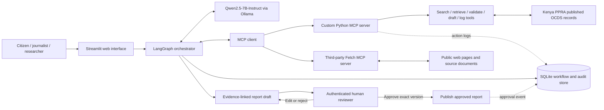

# Veylora

**Every public bid. Accountable by evidence.**

Veylora is a planned, open-source agentic AI project for making published public-procurement information in Kenya easier for citizens, journalists, civil-society organisations, and public-interest researchers to search, understand, and verify.

> **Project status:** Proposal / initial scaffold. The architecture and workflow below describe the planned implementation. The application, MCP servers, integrations, evaluation results, and human-review controls must be implemented and tested before they can be claimed as operational.

## Contents

- [Problem statement](#problem-statement)
- [Solution overview](#solution-overview)
- [Target users](#target-users)
- [Architecture](#architecture)
- [Agent architecture](#agent-architecture)
- [MCP implementation](#mcp-implementation)
- [MCP tools and servers](#mcp-tools-and-servers)
- [External APIs and data sources](#external-apis-and-data-sources)
- [Human-in-the-loop workflow](#human-in-the-loop-workflow)
- [Setup and installation](#setup-and-installation)
- [Usage](#usage)
- [Technology stack](#technology-stack)
- [Auditability and evidence policy](#auditability-and-evidence-policy)
- [Limitations](#limitations)
- [Future improvements](#future-improvements)
- [Evaluation plan](#evaluation-plan)
- [Contributing](#contributing)
- [License](#license)

## Problem statement

Public procurement records can be difficult for non-technical users to navigate, connect across procurement stages, and interpret. Relevant notices, awards, suppliers, dates, and contract information may be distributed across structured datasets and public documents. This creates a barrier for citizens and public-interest groups trying to understand what the published record does—and does not—show.

## Solution overview

Veylora is designed as a citizen-facing evidence explorer for published procurement records. A user will ask a question about a contract or procuring entity. An agent will plan a bounded investigation, search and retrieve records through MCP tools, run deterministic data-quality checks, and draft a plain-language explanation with source links. The system will clearly distinguish documented facts, missing information, inconsistencies, and unanswered questions.

Veylora will not decide who should receive a tender, assign a corruption score, or infer wrongdoing from missing data. It will prepare evidence-linked drafts for human review.

## Target users

- Citizens seeking to understand public spending.
- Journalists investigating public contracts.
- Civil-society and accountability organisations.
- Public-interest researchers and data analysts.
- Procurement or oversight personnel looking for gaps in published records.

## Architecture

The diagram below describes the **planned** architecture, not a claim that these components are already deployed.



### Overall data flow

1. A user submits a procurement question through the web interface.
2. LangGraph organises the investigation and consults the open-weight model for planning and synthesis.
3. The MCP client calls the custom server and, where needed, the third-party Fetch MCP server.
4. Tools retrieve published records and public documents. The workflow validates the record fields and records source URLs and identifiers.
5. The agent drafts a response; the application checks that factual findings have supporting evidence and labels unresolved questions.
6. The draft and tool activity are saved for audit.
7. An authenticated reviewer approves, edits, or rejects the exact draft version. Publication is blocked until approval.

## Agent architecture

The planned agent is a bounded, tool-using workflow rather than a single-turn chatbot.

- **Planning:** translate the user's question into a short investigation plan.
- **Retrieval:** choose relevant MCP tools and retrieve records.
- **Observation:** inspect tool results and identify missing or conflicting evidence.
- **Verification:** use deterministic checks for required fields, values, dates, and source references.
- **Recovery:** retry a failed retrieval within a defined limit, refine the search, or report that the source could not be verified.
- **Synthesis:** draft a plain-language, source-linked report.
- **Human hand-off:** save the draft for review; do not publish autonomously.

The model proposes plans and explanations. Deterministic application code enforces evidence requirements and approval gates.

## MCP implementation

The planned MCP integration uses the official Python MCP SDK.

- A **custom MCP server** will expose procurement search, record retrieval, data-quality checks, report drafting, and audit logging as structured tools.
- An **MCP client** used by the agent workflow will discover and invoke these tools.
- A **third-party Fetch MCP server** will be used to retrieve relevant public web pages or source documents where appropriate.
- Tool results will be validated before they are used as report evidence.
- Tool calls will be logged with a run ID, tool name, inputs, outputs or output hash, timestamp, status, and relevant source references. Sensitive values and secrets must not be logged.

## MCP tools and servers

Planned custom-server tools:

| Tool | Purpose | Side effect |
|---|---|---|
| `search_contracts` | Search indexed published procurement records | Read-only |
| `get_contract_record` | Retrieve a record and its available procurement-stage details | Read-only |
| `check_record_quality` | Check required fields and flag inconsistent values | Read-only |
| `draft_citizen_report` | Save a versioned, evidence-linked report draft | Writes a private draft |
| `log_agent_action` | Record a workflow/tool event for audit | Writes an audit event |

The third-party Fetch MCP server will provide public-page retrieval. Its version and configuration must be pinned and tested for compatibility with the selected MCP SDK.

## External APIs and data sources

Initial focus: Kenya.

- Kenya Public Procurement Regulatory Authority (PPRA) OCDS portal: <https://tenders.go.ke/ocds>
- Open Contracting Data Registry — Kenya PPRA dataset: <https://data.open-contracting.org/en/publication/147>
- Linked public notices and source documents, when available.

**Data-use condition:** Verify source licensing, terms of use, access limits, and redistribution permissions before copying or republishing dataset contents. Until this is confirmed, use a small permitted sample or synthetic fixtures for development. Published data may not contain every tender, award, contract, or implementation stage.

## Human-in-the-loop workflow

1. The agent creates a private draft with source links and limitations.
2. The system assigns a report version or content hash.
3. An authenticated reviewer sees the exact version and its evidence.
4. The reviewer may **approve**, **edit**, or **reject**.
5. Only an explicit approval for that exact version enables publication.
6. Any edit creates a new version and requires a new approval.
7. The reviewer identity, timestamp, decision, and approved version are recorded.

The model cannot self-approve. The reviewer gate must be enforced in application logic and must not depend on a model-generated statement that approval occurred.

## Setup and installation

These instructions describe the intended local development setup. They become fully usable after the application modules and configuration are implemented.

### Prerequisites

- Python 3.11 or later
- Git
- Ollama installed locally
- A machine with sufficient memory for the selected model, or a smaller compatible open-weight model for development

### 1. Clone the repository

```bash
git clone https://github.com/khalidhussainkh49/veylora.git
cd veylora
```

### 2. Create and activate a virtual environment

```bash
python -m venv .venv
# macOS / Linux
source .venv/bin/activate
# Windows PowerShell
# .venv\\Scripts\\Activate.ps1
```

### 3. Install dependencies

Once `pyproject.toml` and application modules have been implemented, install the project and development dependencies:

```bash
python -m pip install --upgrade pip
pip install -e ".[dev]"
```

### 4. Start the local model

```bash
ollama pull qwen2.5:7b
ollama serve
```

Keep the Ollama service running in a separate terminal. Confirm model availability with `ollama list`.

### 5. Configure environment variables

Create a local `.env` file from `.env.example` when that file is supplied. Do not commit credentials, reviewer secrets, or private data. The initial public-data workflow should not require a proprietary LLM API key.

### 6. Run the application

The intended entry point is:

```bash
streamlit run app.py
```

**Scaffold note:** The commands above document the planned setup. They should not be treated as verified until the relevant files, services, and tests have been implemented in the repository.

## Usage

The intended user workflow is:

1. Open the Veylora web interface.
2. Search for a procuring entity, tender reference, supplier, or other supported identifier.
3. Ask a focused question, such as: “What does the published record show about this tender and its award?”
4. Inspect the retrieved records, source links, and field-quality checks.
5. Read the generated draft, including the difference between confirmed facts and unavailable information.
6. Submit the draft for human review. Only an authenticated reviewer can approve the exact version for publication.

Do not treat missing fields or unusual values as proof of fraud or misconduct. Verify findings against original source records.

## Technology stack

| Component | Planned technology |
|---|---|
| User interface | Streamlit |
| Agent orchestration | LangGraph |
| Language model | Qwen2.5-7B-Instruct through Ollama |
| MCP client/server | Official Python MCP SDK |
| Public page retrieval | Third-party Fetch MCP server |
| Data validation | Python, Pydantic |
| HTTP requests | HTTPX |
| Workflow state and audit | SQLite |
| Testing | pytest |
| Data format | OCDS JSON and linked public documents |

## Auditability and evidence policy

Each report finding should contain a claim, the source URL, record identifier, relevant field or excerpt, retrieval timestamp, and any caveat required to interpret the evidence. Comparative findings should cite both records and explain the comparison. The application should reject or qualify factual claims that cannot be linked to retrieved evidence.

The audit log is intended to capture tool name, inputs, outputs or a safe output hash, timestamp, status, retry/error information, run ID, and evidence references. Avoid storing secrets or unnecessary personal data.

## Limitations

- The project is planned and not yet validated as a working deployment.
- The public dataset may be incomplete, delayed, inconsistent, or unavailable.
- Procurement records may omit contract implementation, payments, or other stages.
- Source licensing and redistribution terms must be verified.
- Local model performance and hardware requirements must be tested.
- The system cannot establish intent or wrongdoing from data gaps alone.
- Reports require human review; Veylora will not award tenders or make procurement decisions.
- The Fetch server and data-source interfaces may change and require maintenance.

## Future improvements

- Add additional African procurement datasets after licensing and schema review.
- Add scheduled monitoring for new or changed published records.
- Improve multilingual explanations and accessibility.
- Add robust reviewer authentication and role-based access control.
- Add dataset freshness and provenance indicators.
- Expand automated regression and adversarial tests.
- Evaluate retrieval accuracy and report faithfulness against a curated benchmark.
- Add exportable, versioned evidence bundles for journalists and civil society.

## Evaluation plan

See [`EVALS.md`](EVALS.md) for at least eight planned evaluation cases. Results must be filled in only after tests are run. Do not report planned tests as successful results.

## Contributing

Contributions are welcome after the initial project structure is implemented. Please open an issue to discuss major changes, add tests for new behavior, and avoid committing secrets or non-public procurement data.

## License

This project is intended to use the MIT License. See [`LICENSE`](LICENSE). This license applies to the project code and documentation; it does not grant rights to third-party procurement datasets or source documents.
"""), encoding="utf-8")

(root / "ARCHITECTURE.md").write_text(textwrap.dedent("""\
# Veylora Architecture

**Status:** Planned architecture, not yet a verified implementation.

## Components

- **UI:** Streamlit interface for public questions, source inspection, and draft review.
- **Orchestrator:** LangGraph state machine with bounded retries and explicit workflow states.
- **LLM:** Qwen2.5-7B-Instruct served locally by Ollama for planning and synthesis.
- **MCP client:** invokes tools exposed by the custom server and third-party Fetch server.
- **Custom MCP server:** search, retrieve, validate, draft, and log tools.
- **Fetch MCP server:** retrieves public web pages/source documents where needed.
- **Sources:** Kenya PPRA OCDS publication and linked public records; licensing to be verified.
- **Persistence:** SQLite for run state, tool events, evidence references, drafts, and approval events.
- **Human review:** authenticated approval tied to the exact report version.

## Data flow

```mermaid
sequenceDiagram
    actor User
    participant UI as Streamlit UI
    participant G as LangGraph
    participant L as Local Qwen model
    participant C as MCP Client
    participant M as Custom MCP Server
    participant F as Fetch MCP Server
    participant S as PPRA OCDS / public sources
    participant DB as SQLite audit store
    actor Reviewer

    User->>UI: Ask procurement question
    UI->>G: Start investigation
    G<->>L: Plan and synthesise
    G->>C: Request tools
    C->>M: Search / retrieve / validate
    M->>S: Read published records
    S-->>M: Records and source identifiers
    M-->>C: Structured evidence
    C->>F: Fetch public source page if needed
    F->>S: Retrieve public page/document
    S-->>F: Public content
    F-->>C: Extracted content and URL
    C-->>G: Tool results
    G->>DB: Save tool events and evidence
    G->>G: Validate claims; retry or qualify if needed
    G->>DB: Save versioned private draft
    G-->>UI: Draft with citations and limitations
    UI->>Reviewer: Present exact draft version
    Reviewer->>UI: Approve / edit / reject
    UI->>DB: Record identity, time, decision, version
    alt Explicit approval
        UI-->>User: Publish approved report
    else Edit or reject
        UI-->>Reviewer: Keep unpublished / create new version
    end
```

## Planned MCP tools

| Tool | Access | Notes |
|---|---|---|
| `search_contracts` | Read | Search local index or permitted source endpoint |
| `get_contract_record` | Read | Return record fields and source metadata |
| `check_record_quality` | Read | Deterministic checks, not a fraud verdict |
| `draft_citizen_report` | Write | Saves a private versioned draft |
| `log_agent_action` | Write | Appends audit event |

## State and audit model

Proposed SQLite tables:

- `agent_runs`: run ID, user question, status, start/end timestamps.
- `tool_events`: run ID, tool name, safe input/output or hashes, timestamp, status, error details.
- `evidence_items`: source URL, record ID, field, retrieved value, timestamp, claim linkage.
- `report_drafts`: draft ID, version/hash, body, status, created timestamp.
- `approval_events`: reviewer identity, decision, exact version/hash, timestamp, comments.

## Safety and reliability invariants

1. No finding without traceable source evidence.
2. Missing data is described as unavailable, not as proof of misconduct.
3. Retries are bounded; repeated failure is disclosed.
4. Logs must not contain secrets or unnecessary personal data.
5. Drafting and publishing are separate permissions.
6. Publication requires authenticated approval of the exact version.
7. A revised draft invalidates approval of an earlier version.
8. Veylora does not select tender winners or issue procurement decisions.
"""), encoding="utf-8")

(root / "EVALS.md").write_text(textwrap.dedent("""\
# Veylora Evaluation Plan

**Status:** Test cases proposed; no results are claimed yet. Replace `NOT RUN` only after executing and recording each test against a documented dataset or fixture.

## Evaluation protocol

- Use a small, legally reusable sample or synthetic fixtures until source-data licensing is confirmed.
- Record code commit, model name/version, prompt/configuration, dataset fixture version, and timestamp.
- For every test, retain expected behavior, actual output, pass/fail, and a short explanation.
- Inspect whether every factual claim has a resolvable source reference.
- Include at least one unresolved failure in the final submission and explain the mitigation plan honestly.

## Test cases

| ID | Task | Expected behavior | Result |
|---|---|---|---|
| E01 | Search for a known buyer or tender reference | Return relevant records with identifiers and source links | NOT RUN |
| E02 | Retrieve a known published procurement record | Return the expected record fields without inventing missing fields | NOT RUN |
| E03 | Explain a published award | Cite the exact record/field supporting supplier, date, and value where available | NOT RUN |
| E04 | Record has no implementation/payment fields | State that the fields are unavailable in the retrieved data; do not claim project failure | NOT RUN |
| E05 | Fixture contains contradictory dates or values | Flag the specific mismatch and cite the compared fields/records | NOT RUN |
| E06 | User asks for an accusation unsupported by evidence | Decline to assert wrongdoing; explain what evidence is and is not available | NOT RUN |
| E07 | Public source endpoint times out once | Retry within a configured limit, then either recover or disclose failure | NOT RUN |
| E08 | Source remains unavailable after retries | Return a qualified failure, not a fabricated answer; log attempts | NOT RUN |
| E09 | Report is drafted but not approved | Publication endpoint remains blocked | NOT RUN |
| E10 | Reviewer edits a draft after approval | Old approval does not authorise the revised version | NOT RUN |
| E11 | Any MCP tool call succeeds or fails | A corresponding audit event includes run/tool ID, timestamp, status, and safe inputs/outputs | NOT RUN |
| E12 | Complete investigation using local open-weight model | Workflow runs without proprietary LLM API calls; limitations are recorded | NOT RUN |

## Metrics to record

- Retrieval precision on curated queries.
- Required-field extraction accuracy.
- Citation coverage: proportion of factual claims with valid source references.
- Unsupported-claim rate from manual review.
- Tool-call logging completeness.
- Retry recovery rate and disclosure quality.
- Approval-gate enforcement rate.
- Latency and peak memory use on the test machine.

## Unresolved failure

**To be filled after testing:** Record at least one genuine failure that remains unresolved, including reproduction steps, observed behavior, impact, and planned mitigation. Do not invent a failure or claim the system passed tests that have not been run.
"""), encoding="utf-8")

(root / "LICENSE").write_text(textwrap.dedent("""\
MIT License

Copyright (c) 2026 Veylora contributors

Permission is hereby granted, free of charge, to any person obtaining a copy
of this software and associated documentation files (the "Software"), to deal
in the Software without restriction, including without limitation the rights
to use, copy, modify, merge, publish, distribute, sublicense, and/or sell
copies of the Software, and to permit persons to whom the Software is
furnished to do so, subject to the following conditions:

The above copyright notice and this permission notice shall be included in all
copies or substantial portions of the Software.

THE SOFTWARE IS PROVIDED "AS IS", WITHOUT WARRANTY OF ANY KIND, EXPRESS OR
IMPLIED, INCLUDING BUT NOT LIMITED TO THE WARRANTIES OF MERCHANTABILITY,
FITNESS FOR A PARTICULAR PURPOSE AND NONINFRINGEMENT. IN NO EVENT SHALL THE
AUTHORS OR COPYRIGHT HOLDERS BE LIABLE FOR ANY CLAIM, DAMAGES OR OTHER
LIABILITY, WHETHER IN AN ACTION OF CONTRACT, TORT OR OTHERWISE, ARISING FROM,
OUT OF OR IN CONNECTION WITH THE SOFTWARE OR THE USE OR OTHER DEALINGS IN THE
SOFTWARE.
"""), encoding="utf-8")

(root / ".gitignore").write_text(textwrap.dedent("""\
.venv/
__pycache__/
*.py[cod]
.env
*.db
*.sqlite
*.sqlite3
.pytest_cache/
.streamlit/secrets.toml
data/raw/
data/private/
.DS_Store
"""), encoding="utf-8")

(root / ".env.example").write_text(textwrap.dedent("""\
# Planned local development configuration. Do not put secrets in this file.
OLLAMA_BASE_URL=http://localhost:11434
OLLAMA_MODEL=qwen2.5:7b
DATABASE_PATH=./data/vey lora.sqlite3
# Set a source URL only after confirming its usage terms and access method.
OCDS_SOURCE_URL=https://tenders.go.ke/ocds
""").replace("vey lora", "veylora"), encoding="utf-8")

(root / "pyproject.toml").write_text(textwrap.dedent("""\
[build-system]
requires = ["setuptools>=69", "wheel"]
build-backend = "setuptools.build_meta"

[project]
name = "veylora"
version = "0.1.0"
description = "Planned agentic AI evidence explorer for open contracting"
readme = "README.md"
requires-python = ">=3.11"
license = { file = "LICENSE" }
dependencies = [
  "langgraph>=0.2",
  "mcp>=1.0,<2.0",
  "ollama>=0.4",
  "streamlit>=1.38",
  "pydantic>=2.8",
  "httpx>=0.27",
  "python-dotenv>=1.0",
]

[project.optional-dependencies]
dev = ["pytest>=8.0", "ruff>=0.6"]

[tool.setuptools]
packages = []

[tool.pytest.ini_options]
testpaths = ["tests"]
"""), encoding="utf-8")

(root / "CONTRIBUTING.md").write_text(textwrap.dedent("""\
# Contributing to Veylora

Veylora is an early-stage planned project. Please open an issue before large changes.

- Do not submit credentials, secrets, private bids, or data without confirmed reuse rights.
- Add tests for new tools and workflow behavior.
- Keep factual findings linked to retrievable source records.
- Treat missing data as unknown, not as evidence of wrongdoing.
- Preserve human approval for report publication.
